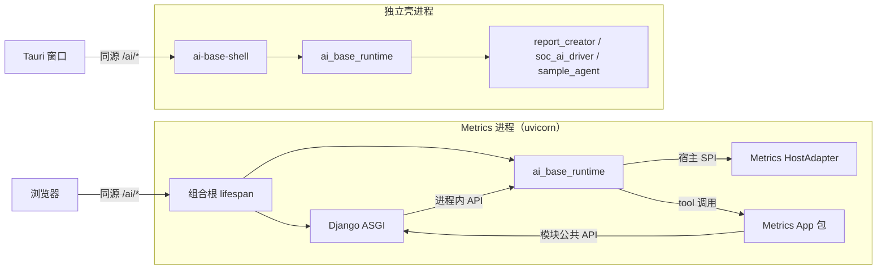

# AI Base 可嵌入运行时：上游架构建议（v2）

- 状态：建议稿，待 AI Base owner 评审。
- 取代：v1《AI Base SDK 中立评估》。v1 以"多个 App 通过网络带外接入"为前提，这个前提已被否定，v1 撤回且未提交。
- 证据基线：AI Base `3c3f8b4`（2026-11-09）。AI Base 路径默认相对于 `services/app-service/`；以 `apps/`、
  `packages/`、`config/`、`openspec/` 开头的路径相对于 AI Base 仓库根目录。Metrics 路径相对于本仓库根目录；以 `specs/`
  开头的路径指本 change 目录下 MDB-2 的 delta spec。
- 编号：F1–F11 沿用 v1（MDB-0 引用了 F1、F3、F11），新发现从 F12 起编。v1 的 AIB-1、MDB-1 撤回，编号不复用。
- 级别：P0 指网页或同机其他用户可以利用、造成凭据泄露或越权写入；P1 指阻断嵌入或影响正确性；P2 指影响局部。

| 编号 | 仓库 | change | 内容 | 时机 |
|---|---|---|---|---|
| AIB-0 | AI Base | `harden-standalone-app-service` | 独立壳热修，不破坏现有集成 | 立即 |
| MDB-0 | Metrics | `harden-ai-base-sidecar-and-connector-inputs` | 删除无效的 token 比对；connector 写路由只收 JSON；`ALLOWED_HOSTS` 只接受回环地址 | 已完成 |
| S0 | Metrics 临时分支 | 不合入 | 共装 spike，验证合并的硬前提 | AIB-2 之前 |
| AIB-2 | AI Base | `extract-embeddable-agent-runtime` | 抽出可嵌入运行时；独立壳切换到同源 UI 和启动密钥 | 与 MDB-2 同版本 |
| MDB-2 | Metrics | `embed-ai-base-runtime-in-process` | Metrics 进程内嵌入运行时，删除全部 HTTP 集成 | 与 AIB-2 同版本 |

## 1. 结论

1. AI Base 的产品本体应当是一个**可嵌入的 agent 运行时**（Python 包），而不是一个必须独立运行的 HTTP 服务。
   独立壳（app-service + Tauri desktop）和 Metrics 是这个运行时的两类宿主。
2. 在"一对一部署、只有 Metrics 嵌入、近期合并"的前提下，v1 设计的跨进程身份机制（JWS 断言、embed ticket、
   平台断言、TLS 档位）已经没有消费方，全部撤回。问题靠删除网络边界来消除，而不是给网络边界加凭据。
3. 嵌入的前提是**进程卫生**：运行时不能改写进程环境变量，不能配置全局可观测性，不能依赖配置单例，不能在
   事件循环上阻塞（F13–F15、F19）。这几条目前都不满足，是 AIB-2 的硬门槛。
4. 宿主和运行时之间只有四个决定点：认证、审批授权、审计、配置注入。Host 校验、请求完整性、`frame-ancestors`
   和"审批只能由人决定"由运行时默认执行，宿主不能关闭。
5. App 专属代码（Metrics 的 connector 和审批胶水、report_creator 的路由、SoC 路由）移出平台核心，成为 App 包。
   connector 改为进程内的类型化 tool，人工审批成为运行时的持久化原语，非聊天任务的档案由 App 包声明并在真实模型上
   执行。受益的是所有 App，不只是 Metrics。
6. 独立壳本身有需要立即修的问题：没有 Host 校验，DNS rebinding 页面可以读到未鉴权端点返回的 instance token
   （F12 + F1）。AIB-0 只做不破坏现有集成的修复；会破坏 Metrics 现有 HTTP 集成的删除，全部放进 AIB-2/MDB-2
   同版本切换一次完成，不建过渡层。
7. 物理合并有真实代价（故障隔离、依赖冲突、单 worker、WSGI→ASGI、发布耦合），见 §6。在一对一本地部署下
   这些代价可以接受，但要先由 S0 共装 spike 拿到证据，再开始 AIB-2。

## 2. 前提修正

### 2.1 v1 的前提为什么不成立

v1 假设 AI Base 是多个 App 共享的平台，App 经网络带外接入，因此需要 App 身份、embed 票据和双向断言。
核实后的部署形态如下（来源：`config/app-profiles.json`）：

| profile | 端口（后端/前端） | 能力 | 形态 |
|---|---|---|---|
| `report_creator`（默认） | 48100 / 1520 | 报告工作流 | 独立壳 |
| `sample_agent` | 48130 / 1530 | 示例 | 独立壳 |
| `soc_ai_driver` | 48200 / 48210 | `socDesignBridge`，接收 SoC Designer GUI 推送 | 独立壳 |
| `dashboard_query_agent` | 48300 / 48310 | dashboardQuery、metricsConnector、grafanaOperations | 为 Metrics 服务 |

内置 App 注册中，除 `metrics-dashboard` 外只有 `*.example.internal` 占位
（`app/services/app_chat_registration.py:61-117`）。每个部署只服务一个 App，不存在需要互相隔离的多个租户。

### 2.2 已确认的前提

- 一个 AI Base 部署只服务一个 App。
- 终态是物理合并：AI Base 作为运行时进入 Metrics 进程。
- 近期实施，不建过渡层：不做配对密钥，不做 BFF 代理，不让 HTTP 和进程内两套调用并行。
- 只有 Metrics 嵌入；其余 profile 继续以独立壳运行。
- Metrics 的 `ALLOWED_HOSTS` 收紧已并入 MDB-0。

### 2.3 判断标准

1. 能删除的边界就不加固：进程内调用不需要凭据。
2. 运行时是产品，宿主是适配器：两类宿主使用同一套公共 API，不存在"Metrics 专用分支"。
3. 默认安全：安全控制由运行时默认执行，宿主只提供身份和配置，不提供关闭开关。
4. 可嵌入就是没有全局副作用：同一进程里可以同时存在两个运行时实例（测试中会用到）。
5. 每条要求都能自动验收：靠一致性测试、导入规则或 grep gate，而不是评审时的记忆。

## 3. 发现

### 3.1 v1 发现在新前提下的处理

| 编号 | 级别 | 发现 | 关键证据 | v2 处理 |
|---|---|---|---|---|
| F1 | P0 | instance token 由未鉴权端点返回，同时被当作 App 凭据 | 返回：`template_runtime/routes/health.py:19`、`app/services/runtime_info.py:92`、`app/routes/diagnostics.py:35-43`；校验：`app/services/app_request_auth.py:83-84,104-123`；desktop 从 runtime info 读取后代为提交：`apps/desktop/src/pages/ChatPage.tsx:76-94`、`apps/desktop/src/lib/api.ts:1952-1953,3100` | AIB-0 从 health 和 diagnostics 中移除；runtime info 仍有消费方（desktop、Metrics launcher），AIB-2 随 instance token 一起删除 |
| F2 | P0 | origin 可以充当认证 | `browser_origin` 模式只检查 origin：`app/services/app_request_auth.py:89-102`；调用方自报的 `X-AI-Base-Host-Origin`：`app/routes/app_chat_bindings.py:195-196`、`app/routes/metrics_workspace_context.py:54-55` | AIB-0 删除 `browser_origin` 模式（没有真实 App 使用）；desktop 仍用 `X-AI-Base-Host-Origin` 完成 Metrics 绑定（`apps/desktop/src/lib/api.ts:1935-1940`），AIB-2 删除 |
| F3 | P0 | 未鉴权的写入路由 | `app/routes/metrics_workspace_context.py:58-70` 调用 `app/services/workspace_app_context.py:59-73`，第 72 行 `require_auth=False` | AIB-0 删除。Metrics 调用的是带认证的 `/api/app-workspace-context-bundles/sync`（`ui_web/ai_base_workbench_adapter.py:136`），不受影响 |
| F4 | P0/P1 | App 凭据进入浏览器；嵌入页没有 `frame-ancestors`；依赖跨源 CORS | `packages/application-sdk/src/widget.ts:42-45,69,74`、`transport.ts:27-32`；嵌入页由 desktop 提供（`apps/desktop/src/App.tsx:136-138`）；CORS 在 `app/main.py:136-142` | AIB-2：删除 `./widget` 和凭据传输；UI 同源托管，嵌入页带 `frame-ancestors 'self'`；删除 CORS（D7） |
| F5 | P1 | 自定义 token 格式，没有最大有效期 | `app/services/app_request_auth.py:179-199`、`:154-160` | 撤销：AIB-2 删除 App 凭据 |
| F6 | P1 | 认证分 header 和 body 两条通道 | `app/routes/app_chat_bindings.py:169-192` | 撤销：同上 |
| F7 | P1 | Python SDK 只有 `TaskRunClient`，`trust_env` 默认为 True | `packages/application-sdk-python` | 撤销：删除 HTTP SDK，由进程内 API 取代（D9） |
| F8 | P1 | 平台核心混有 App 专属代码 | `app/services/app_chat_registration.py:61-117,180-182`；`apps/desktop/src/App.tsx:128-140,569`；`apps/desktop/src/pages/ChatPage.tsx:69-74` 的 Metrics 常量 | 升级为 D4：App 包 SPI |
| F9 | P1 | App 的测试依赖平台私有模块 | Metrics：`scripts/validation/project_full_stack_base.py:223-225`、`scripts/validation/project_summary_base_fixture.py:78-80`、`scripts/validation/project_summary_support.py:158`、`project_management/tests/test_project_full_stack_lifecycle.py:362-363` | 保留：由 testkit 取代（D10），MDB-2 删除这些导入 |
| F10 | 背景 | task-run 只挂在 synthetic candidate 上，并强制 service_account | `app/task_run_candidate.py:63`、`app/routes/task_runs.py:26` | task-run/1 改为与传输无关的契约，删除 HTTP 绑定；在真实模型上执行 App 包声明的档案，principal 由宿主给出（D4、D9） |
| F11 | P1 | connector 方向没有调用方凭据 | `app/services/connectors/client.py:18-41,172-250`、`app/services/connectors/models.py:100-113,172-180` | 消失：connector 改为进程内 tool（D5）。MDB-0 已把 Metrics 的写路由限定为只收 JSON |

### 3.2 新发现

| 编号 | 级别 | 发现 | 证据 | 影响 |
|---|---|---|---|---|
| F12 | P0（与 F1、F3 组合） | app-service 没有任何 Host 校验 | `app/main.py:136-142` 的 CORS 是唯一的中间件；`app/` 中没有 TrustedHost 或等价检查 | DNS rebinding 页面可以以同源身份读取 runtime info 中的 token（F1），调用 F3 写入路由和 SoC 通知（F18）。浏览器的私有网络访问保护并不普遍可用，不能当作防线 |
| F13 | P1，阻断嵌入 | 运行时改写进程环境变量 | `app/main.py:92` → `app/config.py:566-572` → `app/config_runtime.py:86-107`，写入 `HTTP(S)_PROXY`、`ALL_PROXY`、`NO_PROXY` | 嵌入后会改变 Metrics 访问 Jira、Azure、Grafana 时使用的代理；运行期写 `os.environ` 也不是线程安全的 |
| F14 | P1，阻断嵌入 | 可观测性按全局配置 | `app/observability.py:40-50`（全局 `logfire.configure`）、`:51-54`（包装全局 tracer provider）、`:55-63`（全局 `instrument_httpx`、`instrument_pydantic_ai`） | 嵌入后 Metrics 的所有 httpx 调用都会被插桩并按 AI Base 的配置导出，和宿主自己的 tracing 冲突 |
| F15 | P2，阻断嵌入 | 配置是单例 | `app/config.py:575-577`（`@lru_cache(maxsize=1) get_settings()`），环境变量前缀 `RCA_`（`:63`） | 宿主无法显式注入配置；同一进程中不能有两个实例 |
| F16 | P1，阻断嵌入 | 工厂里有 App 分支，服务的生命周期绑定在 FastAPI lifespan 上 | `app/main.py:283`（无条件挂载 `metrics_workspace_context_router`）、`:284-290`（`report_workflow_enabled`）、`:312-328`（`ip_completion_enabled` 下的 SoC 路由）；`:106-131` 的 lifespan 在 finally 中关闭 21 个服务 | 作为子应用挂载时，Starlette 的 `Mount` 不转发 lifespan，服务既不会启动也不会关闭；选择 App 要靠核心代码里的 if 分支 |
| F17 | P1 | 关键状态只在内存中，也没有单写者保护 | `app/services/chat_approval_service.py:35`（审批只在内存）、`app/services/cli_runner/permissions.py:66`（`InMemoryDryRunProofStore`）；portalocker 只用于单个文件加锁（`app/services/model_catalog.py:258`、`app/services/workspace_artifacts.py:327`、`app/services/workspace_catalog_state.py:39`、`app/services/cli_runner/permissions.py:135-162`） | 重启后待决审批丢失；两个进程（例如 Metrics 服务和 `project_run --execute-local`）指向同一个状态目录时，内存状态会分裂 |
| F18 | P2 | SoC 桥接入口没有鉴权 | `app/routes/soc_bridge.py:12-17`：`POST /api/soc/bridge/notify` 直接调用 `record_notify()` | 同机任意进程（以及 F12 下的网页）都可以伪造 SoC Designer 事件 |
| F19 | P1，阻断嵌入 | 协程里执行阻塞的子进程调用 | `app/services/cli_runner/tool_binding.py:55` 的 `async def handler` 在第 74 行同步调用 `runner.run`，后者在 `app/services/cli_runner/runner.py:175` 执行 `subprocess.run(timeout=...)` | 独立壳中会冻结 AI Base 的全部 I/O；嵌入后会冻结 Metrics 的全部 HTTP 处理，直到子进程结束或超时 |

## 4. 架构决定



### D1 一个运行时，两类宿主

- AI Base 发布 Python 包 `ai-base-runtime`（导入名 `ai_base_runtime`），内容包括 agent、tool 执行、审批、会话、
  task-run、skill 和 UI 资产，不含任何 App 专属代码。
- 构造和运行分开：
  - `create_runtime(settings, host, apps)` 只做纯构造：不做 I/O，不启动线程，不读环境变量，不获取锁。
  - `async with runtime.running():` 获取状态目录独占锁，打开存储，启动后台任务；退出时按相反顺序关闭全部服务，
    取代 `app/main.py:106-131` 的 lifespan。
- 两类宿主：
  - 独立壳 `ai-base-shell`：uvicorn + 运行时 + Tauri 窗口，按 profile 装载 App 包，服务 report_creator、
    sample_agent、soc_ai_driver。
  - Metrics 组合根：Django 和运行时在同一个 uvicorn 进程中，由组合根的 lifespan 进入 `runtime.running()`（§5.1）。
- 删除 `dashboard_query_agent` profile。它的 agent、tool 和审批逻辑迁到 Metrics 仓库，成为 Metrics 的 App 包（D4）。
- 验收：两类宿主都通过同一套宿主一致性套件（D10）。

### D2 进程卫生：嵌入的硬门槛

| 规则 | 现状 | 做法 |
|---|---|---|
| 不写 `os.environ` | F13 | 代理配置放进 `NetworkPolicy`。运行时自建的 httpx client 显式传入代理，并设 `trust_env=False`；需要代理的子进程通过显式的 `env` 参数传入 |
| 不做全局可观测性配置 | F14 | 只使用宿主注入的 `TracerProvider`，只对运行时自建的 httpx client 和 agent 插桩。全局 `logfire.configure` 由独立壳在自己的入口调用 |
| 没有配置单例 | F15 | `RuntimeSettings` 是普通的 pydantic 模型，由宿主构造后传入。读取 `RCA_` 环境变量只在独立壳入口做一次 |
| 不在事件循环上阻塞 | F19 | 子进程改用 `asyncio.create_subprocess_exec`，或者用 `asyncio.to_thread` 包装同步调用；同步文件锁同样处理 |
| 没有模块级可变单例 | — | 状态都挂在运行时实例上 |
| 不改进程级设置 | — | 不安装信号处理器，不调用 `logging.basicConfig`，不改工作目录和 `sys.path`，不设置事件循环策略 |

验收（D10 一致性套件）：运行前后 `os.environ` 快照一致；全局 tracer provider 没有变化；asyncio debug 模式下
没有超过 100 ms 的回调；同一进程中两个使用不同状态目录的实例可以同时运行。

### D3 宿主 SPI：四个决定点

宿主只决定四件事：

1. 认证：`authenticate(request) -> Principal | None`，只回答"这是谁"。返回 `None` 或抛出异常都按 401 处理
   （fail closed）。运行时只从这里得到 principal，从不信任请求体或 tool 参数里的 actor。
2. 审批授权：`can_decide(principal, approval) -> bool`。
3. 审计：`record_audit(event)`，接收会话、tool 调用、审批和认证失败事件；认证失败事件带路径、客户端地址与原因，
   不带凭据。事件写到哪里由宿主决定：认证失败可由未认证的请求无限触发，宿主应只写日志，不写持久化审计。
4. 配置注入：`HostConfig` 提供状态目录、允许的 Host、挂载路径、`NetworkPolicy`、`TracerProvider`、模型凭据
   （`SecretStr`），以及是否允许匿名 principal 决定审批。

对自己挂载的 ASGI 应用，运行时默认执行以下控制，宿主不能关闭：

- Host 校验：只接受 `HostConfig.allowed_hosts` 中的 Host，列表为空时拒绝启动。必须正确解析 IPv6 字面量
  （`[::1]:port`），由测试覆盖。
- 请求完整性：非安全方法只接受 `application/json`；带 `Sec-Fetch-Site` 时必须是 `same-origin`；带 `Origin` 时
  必须和请求自身的 origin 一致。不返回任何 CORS 响应头。
- 资源归属：会话、审批和任务只对创建它们的 principal 可见，其他 principal 访问时返回 404。
- 嵌入页带 `Content-Security-Policy: frame-ancestors 'self'` 和 `X-Frame-Options: SAMEORIGIN`。

这样划分的理由：

- 身份由宿主决定，因为只有宿主知道自己的用户：Metrics 是可选的 Basic 认证（`metrics/middleware.py:10-62`），
  独立壳是用启动密钥换来的会话 cookie（D11）。
- 请求完整性由运行时统一执行，因为它和宿主无关；如果两类宿主各写一遍，很容易漏掉。
- 宿主自己的 Python 代码直接调用运行时 API 时显式传入 principal。这属于进程内的可信调用，不经过上述 HTTP 控制。

### D4 App 包 SPI，与平台解耦

- `AppPackage` 声明一个 App 的全部专属内容：
  - agents：指令、模型策略和可用的 tool；
  - tools：带类型的 tool（D5）；
  - task profiles：非聊天任务的档案（见下文和 D9）；
  - context providers：校验 `ContextRef`，并按它在服务端拉取上下文（D5），取代推送式的 workspace context 同步；
  - host actions：iframe 可以请求宿主执行的纯 UI 动作和它们的 schema，取代 `app_chat_registration.py` 中的
    `host_actions`；
  - skills，以及可选的附加路由（挂在 `/ai/apps/{app_id}/` 下）。
- 命名：App 包对外可见的名字都在 `<app_id>.` 命名空间下。tool 名称由运行时自动加前缀（Metrics 的 `publish_chart`
  注册为 `metrics.publish_chart`）；context provider、host action、档案 id 和 `session_key`（D7）由 App 显式写出
  前缀，分别由 `create_runtime` 和 `open_session` 校验。
- 核心不导入任何 App 包，也不出现任何 App 名称，由导入规则和 grep gate 保证（D10）。
- 独立壳按 profile 选择 App 包，删除 `create_app` 中的 App 分支（F16）：
  - `report_workflow_enabled` 下的 report_tasks、review、preflight、demo、rca_profile、rca_contacts 路由
    （`app/main.py:284-290`）移入 `report_creator` 包；
  - `ip_completion_enabled` 下的 soc_projects、sessions、bridge 路由（`app/main.py:312-328`）移入 `soc_ai_driver` 包；
  - Metrics 专属内容从 AI Base 删除，由 Metrics 的 App 包取代：
    - 路由：`app/routes/metrics_workspace_context.py`（`app/main.py:283` 无条件挂载）、`app/routes/dashboard_chat_shortcuts.py`；
    - 服务：`app/services/dashboard_*.py`（9 个文件）、`app/services/connector_workspace_boundary.py`、
      `app/services/workspace_context_boundary.py`（见 D5）；
    - connector：整个 `app/services/connectors/`（见 D5）和 `config/dashboard/metrics-connector-operations.json`；
    - 分支：`dashboardQuery` 能力判断（`app/main.py:102`）、只在 dashboard/Grafana 能力下启用的 CLI connector hook
      （`app/services/cli_runner/activation.py:120`）、内置的 `metrics-dashboard` 注册。
  - agent_foundation、skill_host、skill_control、skill_catalog、style_studio、rag（`app/main.py:291-307`）是平台
    能力，留在核心，作为运行时设置项。
- App 专属的前端代码跟着 App 包走，例如 `packages/application-sdk/src/reporting.ts` 归 report_creator。
- task profiles：App 包用 `AppPackage.task_profiles` 声明自己的非聊天任务档案，运行时负责校验，并在真实模型上执行
  （D9）。`TaskProfile` 的字段：

| 字段 | 约定 |
|---|---|
| `id`、`version` | `id` 按上面的命名规则带 `<app_id>.` 前缀；`version` 发布后不可变，提交时按精确值引用，不接受 `latest`（沿用 `template_runtime/task_runs/contracts.py:23-32`） |
| `input_schema`、`output_schema` | JSON Schema 2020-12，只允许本地 `$ref`（沿用 `template_runtime/task_runs/compiler.py:32-33,74,78-79`）。运行时在受理时校验输入，在完成时校验输出 |
| `agent` 或 `instructions` | 绑定本 App 包的一个 agent，或直接给出指令，只复用指令和模型策略。档案运行不挂 tool，只看显式输入（沿用 `compiler.py:141` 的 `explicit_only` 和 `toolPolicy: none`），没有会话、`ContextRef` 和交互式审批；需要副作用时，由 App 拿到校验过的输出后自己执行 |
| `limits` | 输入和输出字节数、输出 token 数、运行时长，只能比 `RuntimeLimits` 更严 |
| `enabled` | 为假时，提交在受理阶段被拒绝（D9） |

- `create_runtime` 启动时校验全部档案：schema 本身合法、`id@version` 唯一、前缀与 `app_id` 一致，任何一条不满足，
  运行时都不启动。档案定义按 D6 的规范化算法得到 `definition_sha256`，记入每次运行，并参与请求指纹。
- 随之删除两项机制：
  - vendored 契约包：`app/services/task_runs/pack.py`（硬编码 `fixture.extract`、`project-reporting.summary` 两个
    档案及其 system prompt `:61-76`，冻结的设计摘要 `:12-29`，`synthetic_only` 清单 `:98-105`，默认输出到
    `packages/task-run-contract/releases/0.1.0a2` `:114`）、`packages/task-run-contract/`、
    `tests/test_task_runs_pack.py`，以及 `tests/test_import_boundaries.py:20` 对它的豁免。宿主需要的数据模型直接从
    `ai_base_runtime.contracts` 导入，不再复制 schema 文件；
  - `ScopeGrant`（`template_runtime/task_runs/contracts.py:83-88`）及其全部语义：`RunSubmit.scope_key`（`:65`）、
    `RunSnapshot` 中的 scope 和 `grant_revision`（`:165-166,174`）、请求指纹中的 scope（`compiler.py:105-114`）、
    服务中的 grant 检查（`app/services/task_runs/service.py:48-54,64-65,158-170,215`），以及
    `template_runtime/task_runs/__init__.py:24,29`、`app/schemas_task_runs.py:16,22` 的导出。
- 授权只有两个来源：宿主给出的 principal，以及声明该档案的 App 包。运行的归属和幂等命名空间是
  （principal, app_id, `client_run_key`）。App 的业务范围（例如 Metrics 的 `projects.<id>.stages.<id>`）是 App
  自己的输入字段或 run key 的一部分，由 App 自己校验。
- 为什么放在平台而不是各 App：
  - schema、版本和定义摘要的校验由平台统一完成，每个 App 不用 vendor 契约包就能得到同样的保证；核心也不再内置
    任何 App 的档案；
  - grant 来自 v1 的多 App 网络部署前提，由运营方登记 scope（AI Base
    `openspec/changes/define-app-scoped-task-run-contract/design.md:115-135`）。进程内的宿主已经给出 principal，
    再加一份 grant 文档就成了第二个授权来源，还要同步 revision。
- 每个 App 得到的：
  - report_creator：报告审阅改为档案，输出经过 schema 校验，取代伪造的聊天会话 `review:{report_task_id}`、静默的
    mock 回退和正则兜底解析（`app/services/review_agent_service.py:176-194,307-320`）；
  - soc_ai_driver：流水线的四个 agent（`app/services/soc/pipeline/orchestrator.py:68-71`）中，抽取、核验、合规三个
    还是 Phase 2 桩（同目录 `extraction_agent.py:47-51`、`verification_agent.py:44-48`、`compliance_agent.py:45-49`），
    改为档案后直接在真实模型上运行；
  - sample_agent：带一个最小档案，作为新 App 的模板；
  - Metrics：删除 vendored 的 `project_management/ai_bundle/strict-summary/task-run-contract-0.1.0a2/`（档案
    project-summary、document-extract，schema RunSubmit、RunResult、RunSnapshot、RunCancelRequest/Response、
    ErrorEnvelope、CandidateLimits、ScopeGrant），改为 Metrics App 包声明的 `metrics.project_summary` 和
    `metrics.report_authoring`（后者取代 `project_management/ai_bundle/report-authoring/` 中的
    `project-reporting.authoring`）。document-extract（`fixture.extract`）在 Metrics 中没有调用方，随契约包删除。
- 收益不只属于 Metrics：每个 App 都可以单独测试和发布，平台升级不再需要改动 App 分支。

### D5 带内 tool，取代 connector

- tool 用 pydantic 模型声明参数和结果，并声明 `effect`：
  - `read`：只读，按 principal 的数据范围执行；
  - `write`：修改宿主的本地状态，审批策略由 App 声明，默认需要审批；
  - `external`：产生外部可见的副作用（例如发布到 Grafana），**必须**审批，App 不能关闭。
- `write` 和 `external` 可以提供 `preview(params, ctx)`，审批界面展示的就是将要执行的内容。
- `ToolContext` 提供 principal、run_id、tool_call_id（作为幂等键）、`context_ref`、deadline 和取消信号；审批通过后，
  还提供 `approval`（`decided_by`、`decided_at`、`preview`、`preview_digest`，见 D6）。
- `ctx.context_ref` 是会话当前绑定的、经宿主校验的、只含 id 的 `ContextRef`：
  - 形状：`ContextRef(kind, values)`。`kind` 必须是某个 App 包声明的 context provider；`values` 只允许字符串、整数、
    布尔值，以及由它们组成的扁平列表。按 D6 规范化后不超过 `RuntimeLimits.max_context_ref_bytes`（默认 4 KiB），
    超出则绑定失败；
  - 绑定：只能经 `open_session` 和 `context-changed`（进程内是 `bind_context`，见 D7）。运行时先检查形状，再调用
    context provider 的 `validate(principal, ref)`。模型、tool 参数和 iframe URL 都无法设置它；
  - 时机：每次运行开始时取快照，整次运行内不变，审批通过后的执行和 D6 的重新预览也用这个快照。运行中途的重新绑定
    只影响之后的运行。会话没有绑定时为 `None`；
  - 地位：运行时只把它当作不透明、有大小上限的数据，不解释内容，也从不当作授权。模型看到的上下文只来自 provider 的
    `resolve(principal, ref)`，在服务端按当前 principal 拉取；tool 按它复核自己的边界，越界时返回 App 自己的
    `ToolError`（Metrics 是 `CONTEXT_BOUNDARY_VIOLATION`）。
- 为什么放在平台：模型触发的 tool 调用属于哪个会话，只有运行时知道；整次运行使用同一个快照，也只有运行时能保证。
  现在平台反而持有 Metrics 的边界语义：`app/services/connector_workspace_boundary.py:17-34`、
  `app/services/connectors/tool_binding.py:24-27,87-129`（`connector_workspace_boundary_*` 错误码）和
  `app/services/workspace_context_boundary.py`，这些随 D4 删除。宿主推送的任意 `AppChatContext.data`
  （`app/schemas.py:1421-1427`，由 `app/services/app_chat_bindings.py:169-206` 保存，`:297-298` 拼进模型上下文）
  也不再进入模型。
- 每个 App 得到的：report_creator 的报告任务、soc_ai_driver 的项目和 IP、Metrics 的工作台范围
  （`specs/provider-ai-dashboard-composition/spec.md:72-79`、`specs/ai-centric-metrics-workspace-composition/spec.md:5-19`）
  用同一个机制表达"这次对话在看什么"，越界检查都在 tool 里按同一个快照完成。
- 规则：
  - 操作者只能取自 `ctx.principal` 或 `ctx.approval.decided_by`，参数里不允许出现 actor；
  - `external` tool 必须以 tool_call_id 作为幂等键；
  - 运行时只接受 async handler，宿主的同步代码由宿主自己包装（Metrics 用 `sync_to_async`，并在工作线程中调用
    `close_old_connections`）。
- 提示注入：Jira 工单文本、文档内容和网页都当作不可信数据。防线不靠提示词，而靠结构：`external` 必须人工审批并
  展示预览；参数经过 schema 校验；模型无法决定审批；host action 只能是 UI 动作。
- 取代的内容：
  - AI Base 的 connector 框架 `app/services/connectors/`（F11）。它的注册表只登记了 Metrics 一个 connector
    （`app/main.py:159-165`），`app/services/agent_runtime.py:81-97` 把 connector 绑定和 CLI tool 绑定合并后交给 agent。
    改为 App 包 tool 后整个框架删除，agent 的 tool 统一来自运行时的 tool 注册表；
  - Metrics 的 14 个 `/api/ai-dashboard/*` connector 路由（`ui_web/urls.py:227-240`）。

### D6 审批：持久化的运行时原语

- 审批记录保存在状态目录中，进程重启后仍然存在（F17）。生命周期：pending → approved / denied / expired；approved
  执行时变为 consumed，执行前过期变为 expired，重新预览不一致变为 invalidated。
- 每条审批绑定 run_id、tool_call_id、tool 名称、规范化的参数摘要、preview 摘要和 `expires_at`。现在的
  `PendingChatApproval`（`app/services/chat_approval_service.py:16-28`）只有 tool_call_id 和展示文本，没有参数摘要、
  预览和决定人，过期也只在消费时按 900 秒检查（`:139-162`）。执行时 tool_call_id 和参数摘要必须一致，杜绝"批的是
  A，执行的是 B"。
- 规范化只定义一次，由 `ai_base_runtime.contracts` 导出 `canonical_json` 和 `canonical_digest`：先
  `model_dump(mode="json")`，再按键排序、使用紧凑分隔符、非 ASCII 转义为 `\uXXXX`、拒绝 NaN，UTF-8 编码后取 sha256。
  这就是 `template_runtime/task_runs/compiler.py:16-21` 现有的算法，审批、`ContextRef`（D5）和档案定义摘要（D4）共用。
- preview 摘要绑定：
  1. `write` 和 `external` tool 可以声明确定性的 `preview(params, ctx)`，返回 App 自己的 pydantic 模型。运行时保存它的
     规范化字节和摘要，审批界面同时展示参数和预览。preview 失败时不创建审批，错误作为 tool 结果返回给模型；
  2. 执行已批准的调用前，运行时先核对 tool_call_id、参数摘要和过期时间，再用同一个 ctx 快照（principal、
     `context_ref`）重新运行 preview。摘要不一致时审批变为 invalidated，不调用 handler，tool 结果为
     `approval_invalidated` 并提示重新审批，审计同时记录两个摘要；
  3. handler 收到 `ctx.approval`：`preview`（批准时的规范化字节）、`preview_digest`、`decided_by`、`decided_at`。预览
     本身就是待执行载荷时（例如 dashboard JSON），handler 执行的就是这份批准的字节，App 可以再自行复核。
- 为什么放在平台：只有调度 tool 调用的运行时，能在调用 handler 之前重新预览、作废审批并持久化结果。放在 App 里，
  每个 App 都要自建一套审批存储，Metrics 的 `AiGrafanaPublishApprovalService` 就是这样来的。规范化只定义一次，
  所有 App 的摘要语义相同，审计记录也能离线复核。
- 每个 App 得到的：Metrics 发布图表时，摘要覆盖 `{dashboard, target:{grafana_base_url, uid}}`
  （`specs/ai-dashboard-publish-authority/spec.md:5-19,56-74`）；report_creator 的报告定稿（`app/routes/review.py:74-80`）
  和 soc_ai_driver 的补丁审阅（`app/routes/soc_sessions.py:239-251`，现在只确认收到）都可以做成带预览的 `write`
  tool，批准的就是将要写入的内容。
- 只有通过认证且 `can_decide` 为真的 principal 才能决定。决定的入口有两个：
  - 运行时 UI 发出的同源 JSON 请求，受 D3 的请求完整性控制；
  - 宿主在自己的、受 CSRF 保护的视图中调用 `runtime.approvals.decide(...)`。
- 模型永远不能决定审批：没有任何 tool 能产生审批决定。
- 匿名 principal 默认不能决定审批，宿主必须在 `HostConfig` 中显式允许。Metrics 只在开发配置中允许。
- 尽量映射到 pydantic-ai 的延迟 tool 和 tool 审批机制；它能否满足持久化和重启语义，由 S0 验证。
- 在现有的 `ChatApprovalService`（`app/services/chat_approval_service.py:35`）上扩展，不另起一套。Metrics 的
  `AiGrafanaPublishApprovalService`（`bug_metrics/app/api/ai_dashboard_approval.py`）随之删除。
- 审批的请求、决定、消费和过期都写入审计。

### D7 同源 ASGI 与嵌入 UI

- `runtime.asgi_app()` 提供 `/ai` 下的全部 HTTP 接口：API（`/ai/api/...`）、带内容哈希并长期缓存的 UI 资产
  （`/ai/assets/...`）、页面，以及嵌入页 `/ai/embed/chat/{session_id}`。
- 预构建的 UI 打包在 wheel 里。宿主构建时不需要 Node，也不 vendor 运行时的任何前端代码。
- 嵌入流程：
  1. 宿主视图在服务端调用 `runtime.chat.open_session(principal, app_id=..., agent=..., context_ref=...,
     session_key=...)`，得到 `session_id` 和嵌入路径；
  2. 宿主页面渲染指向嵌入路径的 iframe，并加载运行时提供的 `embed-host.js`（地址由
     `runtime.ui.asset_url("embed-host.js")` 给出，带内容哈希）；
  3. iframe 和宿主页面同源，iframe 内的请求自动带上宿主的认证（Basic 或会话 cookie），不需要任何票据。
- `open_session` 是幂等的"打开或恢复"：
  - 以（principal, app_id, session_key）为键。状态库对这个三元组加唯一约束，并发调用只会得到一个会话。恢复时绑定
    本次传入的 `context_ref`（按 D5 校验）；
  - `session_key` 由 App 命名空间限定：必须以 `<app_id>.` 开头，只含 `[A-Za-z0-9._:-]`，总长不超过 200 个字符，否则
  返回 `session_key_invalid`。
    不传 `session_key` 时总是新建会话；
  - 恢复时传入的 agent 与会话已有的 agent 不一致，返回 `session_agent_mismatch`；
  - 取代现在的 App chat binding：它按（source_app_id, session_key）查找会话，不区分 principal，同一 App 的两个用户
    会拿到同一个会话（`app/services/app_chat_bindings.py:82-85`），另外还有四种 `session_mode`（`app/schemas.py:1436`）
    和三个专用错误码（`app/services/app_chat_bindings.py:86-122`）。`app/routes/app_chat_bindings.py` 的 9 个路由和
    `app/services/app_chat_binding*.py` 全部删除。
- postMessage 契约 `ai-base.embed/1`。双方都校验 `event.origin === location.origin` 和 `event.source`：
  - iframe → 宿主：`ready`，以及 `host-action`（只能是 App 包声明过的 UI 动作，例如跳转到某张图表）；
  - 宿主 → iframe：`theme`（亮色/暗色模式，加上一小组允许的设计 token），以及 `context-changed`（只传
    `ContextRef`，上下文数据由 App 包的 context provider 在服务端拉取）；
  - `context-changed` 重新绑定**同一个**会话的 `ContextRef`：iframe 经同源 API 提交（受 D3 的请求完整性控制），运行时
    按 D5 校验后，从下一次运行起生效；不新建会话，也不改变 `session_key`。校验失败时保留原绑定，iframe 显示错误。
    进程内的等价调用是 `runtime.chat.bind_context(principal, session_id, context_ref)`；
  - 有服务端效果的操作一律走 tool 和审批，不走 postMessage。
- 会话的打开、恢复和重新绑定为什么放在平台：会话按 principal 隔离、并发打开只得到一个会话，都要靠运行时的状态库
  保证。让 App 自己维护映射表，每个 App 都要重新解决同样的并发和归属问题。
- 每个 App 得到的：report_creator 按报告任务、soc_ai_driver 按 IP 恢复会话；独立壳的"新对话"不传 key；Metrics 用
  `metrics.workbench.<profile_id>`（`specs/unified-metrics-workbench-ui/spec.md:27-46`），切换 range 或图表时只重新
  绑定 `ContextRef`。
- 否决的方案：
  - 用 custom element / Web Component 直接注入宿主 DOM：样式和脚本会与宿主的设计系统冲突，React 运行时会进入
    宿主页面，两边的版本也难以独立演进；
  - 跨源 iframe：又需要票据和凭据交换，这正是 v1 引入的复杂度。

### D8 状态、事件循环与故障隔离

- 状态目录独占：`running()` 获取 `state_dir/.runtime.lock`。同一状态目录的第二个实例立即得到 `RuntimeBusy`，
  不会等待。
- 事件循环：
  - 运行时运行在宿主的事件循环上，Metrics 下就是 uvicorn 的主循环；
  - 同步调用方（工作线程、CLI）使用 `runtime.blocking` 门面，内部基于 `run_coroutine_threadsafe`。在运行时自己的
    循环线程上调用会立即抛出 `RuntimeUsageError`，以免死锁；
  - 宿主不能用 `asyncio.run` 调用运行时协程。那样会创建第二个事件循环，而运行时的资源绑定在第一个循环上；
  - CLI 使用 `start_blocking()`：在专用线程上启动事件循环并进入 `running()`，同样受状态目录锁约束；
  - Windows 上宿主必须使用 Proactor 事件循环，由一致性套件断言循环类型。
- 故障隔离：
  - 并发运行数、单次运行和单次 tool 调用的超时、捕获输出的大小都有上限（`RuntimeLimits`）；
  - 运行时内部的异常只以 API 错误的形式返回，不会传播到宿主的请求处理中；
  - 关闭时取消未完成的运行，并把它们标记为中断，不会静默丢失。

### D9 公共 API、契约与分发

- 公共接口只有以下模块，其余代码放在 `ai_base_runtime._internal` 下，宿主一旦导入就会被导入规则拦截：

| 模块 | 内容 |
|---|---|
| `ai_base_runtime` | `create_runtime`、`start_blocking`、`AgentRuntime`、`RuntimeSettings`、`RuntimeLimits`、错误类型 |
| `ai_base_runtime.spi` | `HostAdapter`、`HostConfig`、`HostRequest`、`Principal`、`NetworkPolicy`、`AuditEvent`、`ApprovalView` |
| `ai_base_runtime.apps` | `AppPackage`、`TaskProfile`、`tool`、`ToolContext`、`ToolApproval`、`Effect`、`ToolError`、`ContextRef`、`ContextProvider` |
| `ai_base_runtime.contracts` | task-run/1 的数据模型、状态机、错误信封和受理/完成错误码，沿用 `template_runtime/task_runs/contracts.py:109-116` 的 `recovery` 语义；`canonical_json`、`canonical_digest`（D6） |
| `ai_base_runtime.testkit` | 见 D10 |

- 运行时的异步 API 是 `runtime.chat`（含 `open_session`、`bind_context`，D7）、`runtime.task_runs`、
  `runtime.approvals`；`runtime.blocking` 提供同名的同步版本。
- task-run/1 改为与传输无关的契约，删除 HTTP 绑定（`app/routes/task_runs.py`、`app/task_run_candidate.py`，F10）。
  这推翻了 draft 中"本轮不变更"的冻结，需要 draft owner 签署。
- task-run/1 的执行：
  - 档案：`runtime.task_runs.start(...)` 和 `runtime.blocking.task_runs.start(...)` 只执行某个 App 包在
    `task_profiles` 中声明的档案（D4），与聊天走同一条 pydantic-ai 模型管线
    （`template_runtime/services/pydantic_ai_model_factory.py:37-38`），模型取自 `HostConfig`；
  - 删除 synthetic 执行：`app/task_run_candidate.py:34-35`、`app/services/task_runs/service.py:24-35`、
    `template_runtime/task_runs/contracts.py:137` 的 `execution_mode: Literal["synthetic"]`。testkit 的假模型（D10）
    接在同一条管线上，测试和生产走同一套代码；
  - principal：宿主给出的提交用户，不再强制 service_account（`app/routes/task_runs.py:26-27`）。运行的可见性按 D3
    的资源归属，幂等命名空间是（principal, app_id, `client_run_key`）；
  - 完成：输出按档案的 `output_schema` 校验，不符合时运行以 `output_schema_invalid` 失败（沿用
    `app/services/task_runs/service.py:222-225`），从不返回未校验的输出。输入、输出和时长上限取自档案的 `limits`；
  - 审计：结果记录档案 id、version、`definition_sha256`、模型身份（provider 和模型名）和运行时版本，取代现在的
    `backend_id`、`qualification_ref` 和 `execution_mode`（`contracts.py:135-144`）。
- task-run/1 的准入：提交时按下表顺序检查，任何一项失败都不创建运行，直接返回稳定的错误码：

| 错误码 | 条件 | `recovery` |
|---|---|---|
| `profile_not_declared` | 没有任何 App 包声明该 `id@version` | `correct_request` |
| `profile_disabled` | 档案已声明，但 `enabled` 为假 | `stop` |
| `model_not_configured` | `HostConfig` 没有配置模型 | `stop` |
| `input_schema_invalid` | 输入不符合档案的 `input_schema`（沿用 `app/services/task_runs/service.py:84-87`） | `correct_request` |

- 随之删除的错误码：`scope_not_allowed`、`profile_not_allowed`（`app/services/task_runs/service.py:48-54`）、
  `scope_revoked`、`qualification_revoked`（`:158-170,231`）、`backend_not_qualified`、`profile_unavailable`
  （`:78-82`）、`capability_not_supported`（`:124-125`）。`CandidateLimits`（`contracts.py:91-106`）并入 `RuntimeLimits`。
- 为什么放在平台：模型管线、principal 和档案注册表都在运行时里。准入和输出校验放在这里，每个 App 才能得到同样的
  错误码和审计记录；App 不需要、也不应该自己判断"模型是否已配置"。
- 每个 App 得到的：report_creator 和 soc_ai_driver 的档案（D4）直接在真实模型上运行；sample_agent 演示最小的调用；
  Metrics 的 project run worker 以提交用户的身份运行（`specs/embedded-ai-runtime-host/spec.md:100-110`），
  `model_not_configured` 可以直接对应到 AI 状态 `not_configured`，与运行时未运行时的 `RUN_UNAVAILABLE` 区分开
  （同一文件 `:143-156`）。真实模型执行推翻了 draft 冻结的 synthetic-only 范围，见 Q9。
- 删除：
  - Python HTTP SDK `ai-base-application-sdk`（`packages/application-sdk-python`）。AI Base 仓库内只有 app-service 的
    两个测试在用（`tests/test_public_sdk_observation.py`、`tests/test_task_runs_client.py`），外部唯一的消费方是 Metrics；
  - App 注册、App 凭据和 instance token（`app/services/app_chat_registration.py`、
    `app/services/app_request_auth.py`），以及 `X-AI-Base-App-Instance-Token`、`X-AI-Base-Host-Origin` 两个请求头；
  - `@ai-base/application-sdk` 不再作为对外 SDK 发布：`./widget` 和凭据传输（`widget.ts`、`transport.ts`）删除；
    desktop 使用的根导出和 `./first-party` 并入运行时 UI 的内部代码；`./reporting` 归 report_creator 的 App 包。
- 分发：
  - 只发布一个 wheel `ai-base-runtime`，内含预构建 UI。可选依赖按能力拆成 extras，具体划分在 AIB-2 design 中确定；
  - 依赖下限按实际需要声明。当前 AI Base 要求 `portalocker>=4.4.2`，与 Metrics 固定的 `4.4.1` 冲突，S0 时由
    Metrics 升级解决；
  - 版本遵循 SemVer。1.0 之前 minor 版本可以有破坏性变更，所以 Metrics 固定精确版本。

### D10 testkit 与宿主一致性套件

- `ai_base_runtime.testkit` 提供：
  - 可编排的假模型，按脚本发出 tool 调用和文本；
  - 内存版的 `HostAdapter` 和审计接收器；
  - `RuntimeHarness`：异步上下文管理器，创建临时状态目录并运行运行时；
  - 审批辅助（例如 `approve_next()`）和事件记录器；
  - `check_app_package(app, extra_forbidden_fields=...)`：档案 schema 合法、id 带 App 前缀；tool 参数里没有 actor、
    审批 id、证明 id 这类授权字段（App 可以追加自己的字段名，例如 Metrics 的 workspace key）；同一输入两次 preview
    的摘要相同。每个 App 包在自己的测试里调用。
- 宿主一致性套件以 pytest 插件形式提供，每个宿主在自己的 CI 中运行，断言：
  - `/ai/` 上的 Host 校验、未认证返回 401、跨站的非安全请求被拒绝、嵌入页带 `frame-ancestors`；
  - 资源归属：其他 principal 访问返回 404；
  - 模型无法决定审批；匿名 principal 默认无法决定审批；
  - D2 的快照和阈值检查；
  - 状态目录锁：第二个实例得到 `RuntimeBusy`；
  - 在循环线程上调用 blocking 门面立即报错；Windows 上事件循环是 Proactor；
  - 组合根确实进入了 `running()`，以 `/ai/api/health` 报告的运行状态为准；
  - 本提案的五项运行时能力，用 testkit 自带的夹具 App 包验证，不依赖宿主自己的 App：
    - D4：档案 schema 不合法或 id 前缀错误时，运行时不启动；
    - D5：`ctx.context_ref` 是运行开始时的快照，超限、kind 未声明或 provider 校验失败时绑定被拒绝；
    - D6：重新预览的摘要不一致时，审批变为 invalidated，handler 不被调用；
    - D7：同一（principal, app_id, session_key）只得到一个会话，`context-changed` 不新建会话；
    - D9：准入错误码按顺序返回；输出不合 schema 时为 `output_schema_invalid`；结果记录档案和模型身份。
- 导入规则（import-linter 或等价的 gate）：核心不导入 App 包；宿主不导入 `ai_base_runtime._internal`。
- Metrics 删除所有导入 AI Base 私有模块的夹具（F9）。

### D11 独立壳加固

AIB-0：立即实施，不破坏 Metrics 现有的 HTTP 集成。

- 增加 Host 校验，默认只接受 `127.0.0.1`、`localhost`、`[::1]`（F12）。
- 从 health 和 diagnostics 的响应中移除 instance token（`template_runtime/routes/health.py:19`、
  `app/routes/diagnostics.py:35-43`）。desktop 和 Metrics launcher 都只从 runtime info 读取 token，不受影响。
- 删除未鉴权的 `POST /api/metrics/workspace-context/sync`（F3）。
- 删除 `browser_origin` 认证模式（F2）。内置注册和 `config/` 中都没有 App 使用它。
- 残留风险：runtime info 仍返回 token，desktop 仍用 `X-AI-Base-Host-Origin` 完成 Metrics 绑定，SoC 通知仍然没有
  鉴权。有了 Host 校验之后，网页已经无法利用这些问题，但同机的其他 OS 用户仍然可以。它们在 AIB-2 中随整套 App
  凭据一起删除；在此之前，共享主机应把这一点当作已知风险。

AIB-2：与 MDB-2 同版本切换。

- UI 由运行时同源托管，删除 CORS（F4）。
- 启动密钥：
  - 壳生成随机密钥，通过环境变量或 stdin 交给服务进程，不放进命令行参数，因为其他用户能看到进程参数；
  - 窗口打开 `http://127.0.0.1:<port>/ai/#bootstrap=<secret>`。UI 读取 fragment 后立即用 `history.replaceState`
    清除，再把密钥一次性兑换成 `HttpOnly; SameSite=Strict` 的会话 cookie。密钥只能兑换一次；
  - 独立壳的 `authenticate` 只认这个 cookie。
- 防端口抢占：服务进程绑定端口 0，通过 stdout 管道报告实际端口。壳核对监听该端口的进程就是自己的子进程
  （Windows 上用 `GetExtendedTcpTable`），否则拒绝打开窗口。
- Tauri：如果 UI 需要 IPC，capability 的 `remote.urls` 只列出这个回环 origin；不需要 IPC 就不授予。
- SoC 桥接（F18）：服务进程启动时写入一个只有当前用户可读的密钥文件。SoC Designer 读取后以
  `Authorization: Bearer` 发送；通知入口只接受 JSON。这需要 SoC Designer 一侧配合。

### 对各 App 的影响

| App | 变化 | 收益 |
|---|---|---|
| report_creator | 路由和前端 reporting 客户端移入 App 包；独立壳改用同源 UI 和启动密钥；报告审阅改为声明式档案，定稿改为带预览的 tool | 不再受其他 App 分支牵连；同机其他用户无法冒用；审阅输出经过 schema 校验，不再静默回退到 mock |
| sample_agent | 改写为最小的 App 包，带档案、context provider 和带预览的 tool 各一个 | 成为新 App 的模板 |
| soc_ai_driver | SoC 路由移入 App 包；桥接入口加凭据；流水线 agent 改为档案，按 IP 恢复会话 | SoC 事件无法被伪造；流水线在真实模型上运行 |
| Metrics | 进程内嵌入；connector 改为 tool；审批由运行时托管；task-run 档案由 Metrics App 包声明 | 删除全部 HTTP 集成、凭据、launcher 编排和 vendored 契约包 |

## 5. 接口草图

以下为示意，名称在 AIB-2 和 MDB-2 的 design 中确定。

### 5.1 Metrics 组合根

```python
# metrics/asgi.py: the only composition root. It imports ai_host.wiring and nothing from ai_base_runtime.
import os

os.environ.setdefault("DJANGO_SETTINGS_MODULE", "metrics.settings.production")

from django.core.asgi import get_asgi_application

django_app = get_asgi_application()  # django.setup() must run before ai_host imports models

from ai_host.wiring import build_application

application = build_application(django_app)
```

```python
# ai_host/wiring.py: the only Metrics code that constructs the runtime.
import asyncio
from collections.abc import Iterator
from contextlib import asynccontextmanager, contextmanager

from starlette.applications import Starlette
from starlette.routing import Mount

from ai_base_runtime import create_runtime, start_blocking
from ai_host.host import MetricsHost
from ai_host.package import METRICS_APP
from ai_host.settings import ai_mount_path, build_settings
from ai_host.state import attach, detach
from ai_host.task_runs import RuntimeTaskRunPort
from project_management.app.api.project_runs import (
    build_project_runtime,
    clear_project_runtime,
    install_project_runtime,
)

PROJECT_RUN_STOP_SECONDS = 620  # run timeout (600 s) plus grace, same as project_serve today


def build_application(django_app) -> Starlette:
    runtime = create_runtime(build_settings(), host=MetricsHost(), apps=[METRICS_APP])

    @asynccontextmanager
    async def lifespan(app):
        # Starlette's Mount does not forward lifespan events, so the composition root owns them.
        # RuntimeBusy or invalid settings propagate: the server exits with the error code
        # instead of serving Django without the runtime.
        async with runtime.running():
            attach(runtime)  # ai_host views, embed paths and AI pane status
            port = RuntimeTaskRunPort(runtime.blocking.task_runs)
            # Build, start and stop are blocking (start() reconciles interrupted runs from the
            # run archive), so none of them runs on the event loop.
            project_runs = await asyncio.to_thread(build_project_runtime, task_runs=port)
            install_project_runtime(project_runs)
            await asyncio.to_thread(project_runs.start)
            try:
                yield
            finally:
                # The worker may be blocked on a runtime call scheduled on this loop, so stop it
                # off-loop and before the runtime leaves running().
                await asyncio.to_thread(project_runs.stop, PROJECT_RUN_STOP_SECONDS)
                clear_project_runtime(project_runs)
                detach()

    return Starlette(
        routes=[Mount(ai_mount_path(), app=runtime.asgi_app()), Mount("/", app=django_app)],
        lifespan=lifespan,
    )


@contextmanager
def local_task_run_port() -> Iterator[RuntimeTaskRunPort]:
    # CLI processes run their own runtime; RuntimeBusy from the state-dir lock becomes RUN_BUSY.
    with start_blocking(build_settings(), host=MetricsHost(), apps=[METRICS_APP]) as runtime:
        yield RuntimeTaskRunPort(runtime.blocking.task_runs)
```

- `metrics/asgi.py` 只导入 `ai_host.wiring`。Metrics 中只有 `ai_host` 导入 `ai_base_runtime`，由导入规则测试强制
  （`specs/embedded-ai-runtime-host/spec.md:84-89`）；project_management 只认识自己的 task-run 端口，实现由这里注入，
  它不导入 `ai_host`（同一文件 `:91-93`）。
- 挂载路径随 URL 前缀：`METRICS_BASE_URL=/metrics/` 时为 `/metrics/ai`（`:24-27`）。
- 运行时无法进入运行期时，服务以错误码退出，不会只提供 Django 页面（`:33-36`）。关闭时 project run worker 先停止，
  运行时随后停止（`:38-41`）。
- project run runtime 的构造、启动和停止都经 `asyncio.to_thread`：`start()` 会扫描运行档案、恢复中断的运行
  （`project_management/services/project_run_recovery.py:17-29`），放在事件循环上会阻塞循环，触及 ORM 时还会触发
  `SynchronousOnlyOperation`。停止的宽限期沿用 `project_management/management/commands/project_serve.py:70` 的 620 秒。

### 5.2 宿主 SPI 与 tool

```python
# ai_host/host.py and ai_host/package.py (abridged); only ai_host imports ai_base_runtime.
from asgiref.sync import sync_to_async
from django.db import close_old_connections
from pydantic import BaseModel

from ai_base_runtime.apps import AppPackage, TaskProfile, ToolContext, ToolError, tool
from ai_base_runtime.contracts import canonical_digest
from ai_base_runtime.spi import ApprovalView, AuditEvent, HostRequest, Principal


async def run_sync(fn, /, *args, **kwargs):
    # Runtime callbacks have no ThreadSensitiveContext: use a worker thread and drop stale DB connections.
    def call():
        close_old_connections()
        try:
            return fn(*args, **kwargs)
        finally:
            close_old_connections()

    return await sync_to_async(call, thread_sensitive=False)()


class MetricsHost:
    async def authenticate(self, request: HostRequest) -> Principal | None:
        result = check_basic_authorization(request.headers.get("authorization"))
        if result.auth_disabled:
            return Principal(id="local_operator", display_name="Local operator", anonymous=True)
        return Principal(id=result.username, display_name=result.username) if result.ok else None

    async def can_decide(self, principal: Principal, approval: ApprovalView) -> bool:
        return True  # the runtime already rejects anonymous principals unless HostConfig allows them

    async def record_audit(self, event: AuditEvent) -> None:
        if is_auth_failure(event):
            log_ai_auth_failed(event)  # structured log only: unauthenticated requests must not grow the audit table
            return
        await run_sync(write_ai_audit_event, event)


class PublishChart(BaseModel):
    profile_id: str
    chart_id: str


class PublishTarget(BaseModel):
    grafana_base_url: str
    uid: str


class ChartPublication(BaseModel):
    dashboard: dict[str, object]  # deterministic Grafana dashboard JSON
    target: PublishTarget


class PublishedChart(BaseModel):
    dashboard_url: str


async def preview_chart_publication(params: PublishChart, ctx: ToolContext) -> ChartPublication:
    require_in_boundary(params, ctx.context_ref)  # ToolError("CONTEXT_BOUNDARY_VIOLATION") otherwise
    return await run_sync(render_chart_publication, params)  # same params and data -> same bytes


@tool(effect="external", preview=preview_chart_publication)
async def publish_chart(params: PublishChart, ctx: ToolContext) -> PublishedChart:
    # The runtime has re-run the preview and matched its digest; import only the approved bytes.
    publication = ChartPublication.model_validate_json(ctx.approval.preview)
    if canonical_digest(publication) != ctx.approval.preview_digest:
        raise ToolError("PREVIEW_DIGEST_MISMATCH")
    # The operator comes from the approval, never from model-supplied parameters.
    return await run_sync(
        import_publication_to_grafana,
        publication,
        operator=ctx.approval.decided_by,
        idempotency_key=ctx.tool_call_id,
    )


PROJECT_SUMMARY = TaskProfile(
    id="metrics.project_summary",
    version="1",
    input_schema=ProjectSummaryInput.model_json_schema(),
    output_schema=ProjectSummaryOutput.model_json_schema(),
    instructions=PROJECT_SUMMARY_INSTRUCTIONS,
)

METRICS_APP = AppPackage(
    app_id="metrics",
    agents=[DASHBOARD_QUERY_AGENT, TICKET_TRIAGE_AGENT],
    tools=[catalog, chart_workflow, publish_chart],
    task_profiles=[PROJECT_SUMMARY, REPORT_AUTHORING],
    context_providers={"metrics.workbench": WorkbenchContextProvider()},
    host_actions={"metrics.openChart": OpenChartAction, "metrics.openEvidence": OpenEvidenceAction},
)
```

`check_basic_authorization` 是从 `BasicAuthMiddleware` 中抽出的纯函数，Django 中间件和宿主 SPI 共用，保证两边的
认证结果一致。`preview_chart_publication` 是确定性的只读函数，摘要覆盖 `{dashboard, target:{grafana_base_url, uid}}`；
`PROJECT_SUMMARY` 和 `REPORT_AUTHORING` 取代 vendored 的 `project-reporting.summary@review-1` 和
`project-reporting.authoring`（D4）。

### 5.3 blocking 门面与 CLI

```python
# ai_host/task_runs.py: implements project_management's synchronous task-run port.
class RuntimeTaskRunPort:
    def __init__(self, task_runs):
        self._task_runs = task_runs  # runtime.blocking.task_runs

    def start(self, principal, request):
        # Worker threads only: on the runtime's loop thread the blocking facade raises RuntimeUsageError.
        return self._task_runs.start(principal, request, timeout=30)


# manage.py project_run --execute-local, where no server event loop exists. ai_host registers
# local_task_run_port (5.1) as the CLI port factory, so project_management never imports ai_host.
with open_local_task_run_port() as port:  # project_management's own port API
    port.start(principal, request)
# start_blocking raises RuntimeBusy while the server holds the state-dir lock; Metrics maps it to RUN_BUSY.
```

### 5.4 嵌入页

```html
<iframe id="ai-pane" src="{{ ai_embed_path }}" title="AI assistant"></iframe>
{{ ai_context_ref|json_script:"ai-context-ref" }}
<script type="module">
  import { connectEmbed } from "{{ ai_embed_host_url }}";

  const embed = connectEmbed(document.getElementById("ai-pane"), {
    hostActions: {
      "metrics.openChart": ({ chartId }) => openChart(chartId),
    },
  });
  embed.setTheme(document.documentElement.dataset.theme);
  // ai_host builds the id-only ContextRef on the server; the page only forwards it.
  embed.contextChanged(JSON.parse(document.getElementById("ai-context-ref").textContent));
</script>
```

`ai_embed_path` 来自 `open_session(principal, app_id="metrics", agent=..., context_ref=...,
session_key=f"metrics.workbench.{profile_id}")`。range 或图表变化后，页面局部刷新得到新的 `ai_context_ref`，再发送
`context-changed`，同一个会话重新绑定（D7）。

## 6. 物理合并的代价与缓解

| 维度 | 代价 | 缓解 |
|---|---|---|
| 故障隔离 | 运行时的崩溃、内存泄漏或阻塞会直接拖垮 Metrics 页面 | D8 的并发、超时和输出上限；D2 禁止在循环上阻塞，并有 slow callback 门禁；异常只以 API 错误返回 |
| 依赖冲突 | 两套依赖进入同一个 venv，例如 `portalocker` 4.4.1 与 ≥4.4.2 | 单一锁文件；运行时按实际需要声明依赖下限；可选依赖拆成 extras；S0 用 `pip check` 验证 |
| 单 worker | 状态目录锁决定了只能有一个进程；Metrics 的 Docker 镜像从 gunicorn 多 worker 改为单进程 | 本地部署本来就是单进程（`project_serve`）；Docker 单副本运行 `manage.py serve`，吞吐下降由 owner 接受（2026-11-10） |
| WSGI → ASGI | Metrics 从多线程 WSGI 服务改为 uvicorn；开发服务器、静态文件和启动脚本都要改 | Django 原生支持 ASGI，同步视图按请求在线程中执行；开发和生产使用同一个组合根；S0 跑 Metrics 浏览器测试子集 |
| 发布耦合 | AI Base 发版必须跟随 Metrics 发版，回滚也要一起回滚 | Metrics 固定运行时的精确版本；宿主一致性套件作为升级门禁 |
| 事件循环 | 宿主的事件循环类型决定子进程等能力是否可用 | 组合根固定使用 Proactor；一致性套件断言 |
| 机密性 | 模型凭据和 Jira PAT 位于同一进程内存中 | 与现状等价：现在两个进程以同一个 OS 用户运行，本来就能互相读取内存和文件；凭据使用 `SecretStr`，日志脱敏 |
| 同机其他用户 | 回环端口对同机所有 OS 用户开放 | 运行时继承宿主认证；Metrics 未配置 Basic 用户时是匿名模式，这是 Metrics 现有的姿态，但匿名 principal 默认不能决定审批（D6） |
| 启动时间与内存 | Metrics 启动时会加载 AI 相关依赖 | S0 测量；可选能力按需导入 |

## 7. 与 v1 的对照

| v1 | 内容 | v2 |
|---|---|---|
| D1 | 端点不再返回凭据，删除 `instanceTokenId` | 保留并拆分：AIB-0 移除 health 和 diagnostics 中的 token；AIB-2 删除 instance token |
| D2 | 用 JWS client assertion 统一凭据 | 撤回：进程内调用不需要凭据 |
| D3 | embed session、ticket 和跨源 postMessage | 撤回：改为同源 iframe（D7） |
| D4 | origin 只作为声明，不用于认证 | 保留：AIB-0 删除 `browser_origin`；D3 只把 Origin 用于同源校验 |
| D5 | 删除内置注册，平台与 App 解耦 | 保留并扩大为 App 包 SPI（D4） |
| D6 | Python `AppCredential`、按能力拆分的 HTTP 客户端、TLS 档位 | 撤回：删除 HTTP SDK |
| D7 | OpenAPI 契约优先，统一错误信封 | 改写：契约是 Python 公共 API 和 task-run/1 数据模型，错误信封保留 `recovery` |
| D8 | 发布 testkit | 保留，并扩展出宿主一致性套件（D10） |
| D9 | actor、限流、错误码、日志脱敏 | 改写：actor 只取自 principal；限流改为并发上限；保留日志脱敏 |
| D10 | 平台断言和 `PlatformRequestVerifier` | 撤回：connector 改为带内 tool（D5）；人工审批以宿主认证的用户为准（D6） |
| AIB-1 / MDB-1 | 统一 App 身份与 embed session | 撤回，由 AIB-2 / MDB-2 取代 |

## 8. 明确不建议做的事

1. 不建过渡层：不做配对 HMAC，不做 BFF 代理，不让 HTTP 和进程内两套调用并行。
2. 不为"将来可能需要"保留 HTTP SDK 和 task-run 的 HTTP 绑定。真正出现远程消费方时，再基于传输无关的契约设计
   远程绑定。
3. 不用 custom element 或 Web Component 把 AI UI 注入宿主 DOM。
4. 宿主不 vendor 运行时的前端资产。嵌入脚本由运行时提供，版本跟随运行时。
5. 不给安全控制加关闭开关：Host 校验、请求完整性、`frame-ancestors`、审批只能由人决定。
6. 核心中不保留任何 App 判断（`if profile == ...`、`sourceAppId` 常量），由 grep gate 防止回流。
7. 宿主不用 `asyncio.run` 调用运行时协程，也不在运行时的循环线程上调用 blocking 门面。
8. AIB-0 不做会破坏现有集成的删除，这类删除放进切换版本。
9. 不为 Metrics 的多 worker 部署设计分布式状态。单进程是一对一本地部署的前提。

## 9. 迁移顺序与验收

1. **AIB-0**（AI Base 单独发布）。验收：
   - 非回环 Host 返回 400，`[::1]:port` 能被正确解析；
   - health 和 diagnostics 的响应中没有 token；
   - `POST /api/metrics/workspace-context/sync` 返回 404；
   - 使用 `browser_origin` 的 manifest 被拒绝；
   - Metrics 现有的 launcher 端到端流程仍然通过。
2. **S0 共装 spike**（Metrics 临时分支，不合入）。退出条件：
   - 依赖：Metrics 和 AI Base 的依赖可以在同一个 venv 中解析，`pip check` 无冲突；
   - 组合：uvicorn 同时托管 Django ASGI 和挂在 `/ai` 的子应用，组合根的 lifespan 能进入子应用的运行期；
     Metrics 浏览器测试子集通过；
   - 审批：pydantic-ai 的延迟 tool 或审批机制可以把待决调用持久化，进程重启后能继续执行，或被明确标记为中断；
   - 事件循环：Windows 上组合根的循环是 Proactor；从 Django 同步视图线程和 `project-run-worker` 线程调用
     blocking 门面成功；在循环线程上调用立即报错；
   - 性能：Metrics 主要页面的 p95 延迟比现有 `project_serve` 基线劣化不超过 20%；
   - 任何一项不通过就停止 AIB-2，带着证据回到 owner 决策，不预先设计备选方案。
3. **AIB-2**（AI Base）：D1–D11 中属于 AI Base 的部分。以独立壳通过宿主一致性套件作为验收，另外：
   - report_creator、soc_ai_driver、sample_agent 的 App 包都通过 `check_app_package`（D10）；
   - report_creator 的报告审阅和 soc_ai_driver 的流水线 agent 以档案在真实模型上运行，输出经过 schema 校验（D4、D9）；
   - task-run/1 只剩进程内 API：`app/routes/task_runs.py`、`app/task_run_candidate.py`、`app/services/task_runs/pack.py`
     和 `packages/task-run-contract/` 已删除。
4. **MDB-2**（Metrics，与 AIB-2 同版本）：组合根、Metrics App 包、iframe 形式的 AI pane，删除全部 HTTP 集成。
   以 Metrics 通过宿主一致性套件和 Metrics 浏览器测试作为验收，另外：
   - `metrics.project_summary` 和 `metrics.report_authoring` 通过 `check_app_package`，project run worker 经 task-run
     端口以提交用户的身份运行（D4、D9）；
   - 工作台会话按 `metrics.workbench.<profile_id>` 恢复，切换 range 或图表只重新绑定 `ContextRef`（D5、D7）；
   - 发布图表的审批绑定 `{dashboard, target:{grafana_base_url, uid}}` 的预览摘要，重新预览不一致时不导入（D6）。

两个宿主都要满足的自动化验收：

- 宿主一致性套件全部通过，包括用夹具 App 包验证的五项运行时能力（D4、D5、D6、D7、D9，见 D10）；
- 导入规则：核心不导入 App 包；Metrics 不导入 `ai_base_runtime._internal`，也不导入 AI Base 的 `app.*`；
- grep gate：核心中没有 App 名称、没有写 `os.environ`、没有 `logfire.configure`，也没有 `ScopeGrant` 和
  `execution_mode`；Metrics 中没有针对运行时协程的 `asyncio.run`，也没有 `ai_bundle`、`TaskRunClient`、
  `AiBackendTarget`、`execution_mode`；
- D2 的快照和 slow callback 阈值检查；
- 同一状态目录的第二个实例得到 `RuntimeBusy`。

## 10. 需要 owner 确认的决策

| 编号 | 决策 | 建议 | 说明 |
|---|---|---|---|
| Q1 | task-run/1 删除 HTTP 绑定，改为与传输无关的契约 | 同意 | 需要 draft owner 签署，推翻"本轮不变更"的冻结 |
| Q2 | 删除 Python HTTP SDK，`@ai-base/application-sdk` 不再对外发布 | 同意 | 前提是仓库外没有其他消费方 |
| Q3 | `dashboard_query_agent` profile 和 Metrics 专属代码迁出 AI Base，由 Metrics 仓库的 App 包取代 | 同意 | 之后 AI Base 核心不再出现 Metrics 的名称 |
| Q4 | report_creator 和 soc_ai_driver 的路由改为 App 包，留在 AI Base 仓库 | 同意，随 AIB-2 完成 | 核心里的 App 分支必须在 AIB-2 中删除 |
| Q5 | 匿名 principal 默认不能决定审批 | 同意 | Metrics 只在开发配置中允许 |
| Q6 | SoC Designer 改为读取密钥文件并携带凭据 | 同意 | 需要 SoC Designer 一侧配合 |
| Q7 | 运行时固定挂载在 `/ai` | 同意 | 独立壳把 `/` 重定向到 `/ai/` |
| Q8 | 嵌入后的状态目录固定为 `METRICS_STATE_DIR/ai-base`，不迁移 `dashboard_query_agent` 独立壳的现有状态 | 同意 | 会话、审批和技能目录在切换时清空；模型凭据和模型选择改由 Metrics 的 `HostConfig` 提供 |
| Q9 | task-run/1 在真实模型上执行 App 包声明的档案，删除 synthetic 执行、vendored 契约包和 `ScopeGrant`（D4、D9） | 同意 | 推翻 draft 冻结的 synthetic-only 范围，需要 draft owner 签署；授权只来自宿主给出的 principal 和声明档案的 App 包 |
