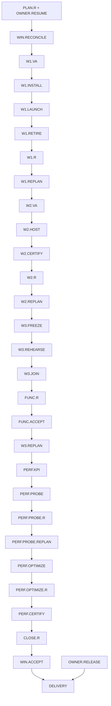

# Windows Closure Implementation Plan

> Agent execution: use the existing OpenSpec ledger with
> `superpowers:executing-plans` or `superpowers:subagent-driven-development`.
> Only `tasks.md` contains execution checkboxes. This document and the JSON DAG
> define work; they do not maintain another progress ledger.

## Goal And Authorization

Finish the owner's four-point **Windows AIB + Dashboard delivery milestone**:
pin the runtime artifact; finish the Dashboard consumer/entrypoint migration;
qualify the real joined workflow and failure lifecycle; then permit a separate
decision about resuming other Apps. This is not full AIB repository release.

- The original planning-only revision was approved and execution resumed by
  the owner on 2026-11-17. The latest owner amendment requires **functional
  acceptance first, performance last**. Independent amendment review precedes
  resuming W2; no second execution approval is required for unchanged scope.
- Update this existing change, not a new competing OpenSpec: the product
  architecture and original requirement IDs remain authoritative.
- Linux, WSL and Linux-container execution is deferred by the owner. Preserve
  their interface/environment definitions; do not mark them tested or remove
  them to make a Windows scan green.
- Other App/generic-capability WIP, live provider/model use, real-user data
  changes and worktree deletion are not authorized here. Scoped mainline
  publication was separately authorized on 2026-11-21; it is not release approval.
- `WIN.ACCEPT` records the Windows milestone. It does **not** archive MDB-2 or
  close AIB `W3.APPS`, `W4.QUAL`, `CLOSE.R`, `DELIVERY`, or original deferred
  MDB-2 requirements. Whole-change archival needs their actual completion or a
  separately approved specification amendment.
- `FUNC.ACCEPT` is the earlier Windows functional milestone, explicitly
  **performance not qualified**. It passed at ff09d6f on 2026-11-20; the
  [functional receipt](evidence/windows-functional-acceptance.json) binds its scope.
  It cannot close original task 10.4 or imply
  final Windows acceptance. Performance work starts only after this milestone
  and `W3.REPLAN`; no other-App expansion precedes functional closure.

## Baseline And Established Architecture

### Dev6 Observer Candidate Refresh (2026-11-22)

The owner authorized AIB Windows testkit observer calibration, independent
review, a new immutable wheel and Dashboard requalification. The source change
is separately reviewed at AIB `3dfa5bd`; the exact candidate identity is in
[the amendment](windows-performance-phase.md#windows-testkit-candidate-amendment-2026-11-22).
Use `D:/AIGC/d6-1122` for the new environment, immutable inputs and evidence.
Non-testkit runtime/assets and dependency declarations are unchanged from dev5.

Renew the same W1/W2/W3/FUNC gates described below for this candidate; no new
DAG nodes, parallel qualifier or progress ledger are added. Fresh outputs are
`evidence/windows-functional-acceptance-dev6.json` and, only after functional
acceptance, `evidence/windows-performance-inputs-dev6.json`. Retain all dev4/
dev5 artifacts and failed attempts. The existing official qualifier, semantic
producers, migration historical-input declaration and exact coverage census
remain authoritative. No private resumption or old-source PASS relabelling.
Performance recipe/KPI and production stop/cancel bounds are unchanged.

### Dev5 Candidate Refresh (2026-11-21)

This subsection preserves the historical dev5 packet. Its method remains the
baseline, but the dev6 amendment above selects the current artifact and paths.

The owner resumed implementation of the dev5 upgrade after mainline publication.
Dashboard starts at `f68138fae673986b430c24791b9e40dec446d8a5`; the selected wheel,
source and final-delivery policy are in
[the candidate decision](windows-performance-phase.md#final-delivery-candidate-decision-2026-11-21).
Use `D:/AIGC/d5-1121` for new installation and evidence. No dev4 environment,
wheel or historical receipt is edited. The table below remains the historical
dev4 milestone baseline, not a claim about the new candidate.

Renew W1.VA/INSTALL/R/REPLAN, W2.CERTIFY/R, W3.FREEZE/REHEARSE/JOIN,
FUNC.R/ACCEPT and PERF.KPI inputs on the new candidate. No new DAG nodes or
second ledger are introduced; the candidate-specific progress is in `tasks.md`.
The upgrade ends at refreshed functional acceptance and performance-input
readiness, not numerical performance certification.

| Authority | Producer | Consumers | Required rejection |
| --- | --- | --- | --- |
| Runtime candidate | Verified dev5 wheel and generated `ai_host/runtime_artifact.json` | admission, requirements, installer, native tests | Old version/hash, incomplete files, shadow/editable install, nonempty Dashboard generic capabilities |
| Dependency lock | Prepared `windows-wheelhouse-lock` JSON | install request/load/run and import probe | Missing/extra/changed wheels, changed manifest, unowned/reparse paths, runtime extras |
| Functional evidence | Fresh native, recovery, browser, module and migration producers | dev5-scoped review and new acceptance receipt | Old candidate/source/fixture bindings or smoke promoted to acceptance |
| Performance inputs | New dev5 policy and accepted functional receipt | performance contract and qualifier | Old/mixed references or changed KPI recipe |

The installation request requires `wheelhouse.manifest={path,sha256}` under
the owned root. Its JSON has `schema_version=1`, `kind=windows-wheelhouse-lock`
and exact `files={wheelFilename:sha256}`. Validate it before creating a prefix,
resolve wheels without network against the locked wheelhouse, and revalidate
before installation and after completion. Existing dependency versions remain
selected, including existing tiktoken; no RAG extras/capabilities are enabled.

New outputs are `evidence/windows-functional-acceptance-dev5.json` and
`evidence/windows-performance-inputs-dev5.json`. The old unversioned dev4
receipts retain their paths and bytes. Active performance references switch
only after dev5 acceptance. Fresh candidate-scoped reviews and negative
cross-candidate checks are required; Sample/RCA results do not substitute.

Preflight disposition: the independent Validation Engineer requested the lock,
capability and versioned-evidence checks above. Implementation must close those
gaps before upgrade acceptance; current package preparation alone is not PASS.

The installation boundary was committed as `3384c40` after actual dev5 install,
47 boundary tests, 19 installed-host tests, 9 launcher tests and an independent
1/1 clean code review. The next wave is amended for historical input ownership:
the existing migration qualifier needs a declared read-only historical artifact
root, since its old source/interpreters/snapshot belong to the retired workspace.
Re-running its old PASS or changing that old owner marker is not permitted.

The optional `migration.historical_inputs` object declares `root`, the exact
historical `repository` label, and `marker={path,sha256}`. Absent declaration
retains the original same-owned-root rule; it does not discover or guess old
paths. Its marker must be the declared root's `owner.json`, bind those labels,
identify `mdb2-windows-closure` with schema version 1 and explicitly prohibit
real user data and external provider/model calls. The retired repository label
is provenance, not an executable path that must still exist.
Roots must be canonical/non-reparse, disjoint from the current source/write
root, and not drive or ancestor roots. Only old-side snapshot, seed, source,
app/base interpreter, pack and old-environment references may use this root.
Candidate environment/inputs, outputs and copied state remain in the new root.
Recheck historical marker/file hashes and existing source/environment identity
before and after the run; validate matching declarations at the receipt consumer.
Wrong/undeclared sibling roots, overlap, changed bytes and stale dev4 receipts
must fail. This extends the existing migration chain, not a second qualifier or
a product SDK compatibility path. Fresh dev5 task10.3 evidence is still required.

| Binding | Value |
| --- | --- |
| Dashboard source | `d0c395eb8649a90d2a2cae09d1f5362252bb0353`; clean at plan creation |
| Amendment baseline | `1dbdd338efaa31f8df1d2f8d9a55a6218c35536e`; existing W2 dirty paths recorded in `evidence/windows-functional-first-baseline.json` |
| Accepted functional source | `ff09d6ff97dd62e56fb3bfc44914c5c08582a144`; all 114 functional keys and 7 module lanes accepted, performance NOT_RUN |
| AIB candidate source | `d589ac8e6572a903edc3846e7d78195e85858868` |
| Runtime | `ai-base-runtime==0.1.1.dev4` |
| Wheel SHA256 | `b332f338f77bf2e966de7495eea6b5968606eb670287588d97a3a4d82905ec94` |
| Artifact/import authority | `ai_host/runtime_artifact.json`, `ai_host/admission.py` |
| Candidate environment | Current explicit interpreter in `docs/development/reporting-delivery.md` |
| Project profile | `.github/skills/lsheng2-dag-based-planning/templates/project-profile.md` |
| Profile/routing | `profile_source=repo-local`; `agent_routing_mode=multiagent-configured` |
| Spec | `proposal.md`, `design.md`, all nine `specs/*/spec.md` deltas |
| Detailed steps | [windows-close-steps.md](windows-close-steps.md) |
| Gates and coverage | [windows-close-validation.md](windows-close-validation.md) |
| Structural graph | [windows-close-dag.json](windows-close-dag.json) |
| Performance phase | [windows-performance-phase.md](windows-performance-phase.md); no second task ledger |

One App, one host process, one security boundary. Django stays threaded WSGI;
the installed runtime owns its loop thread, task execution, sessions and
approvals. `ai_host` owns composition/auth/lifecycle and public runtime adapters.
`project_management` owns business acceptance and native archive bytes;
`bug_metrics` owns chart publication; the existing service lifecycle engine
(SLE) owns process provenance. Do not introduce another SDK, journal, process
manager, bootstrap authority, sidecar fallback or provider abstraction.

Tech stack stays Python 3.13, Django 6.0.7, WhiteNoise 6.12.0, Waitress 3.0.2,
portalocker 4.4.2, the pinned runtime, existing htmx/Meridian UI and local Grafana.
W1 installed and verified this dependency set. W2 and the Windows functional
W3/FUNC gates passed at the accepted source; later documentation-only closeout
does not change those tested product bytes.

### Original Planning Gaps And Current Frontier

- W1 closed the standard dependency, fresh installation and launcher gaps.
  Candidate admission still requires the wheel's
  `direct_url.json.archive_info.hashes.sha256`: a name-only install is not a
  substitute for direct installation of the pinned wheel.
- W1 replaced legacy runtime bindings/launchers through SLE and tested foreign
  process refusal. Do not reimplement completed W1 children.
- The former lifecycle gaps in `serve`/`stop_owned_resources` are implemented
  and covered by the accepted native, recovery and module evidence. Absolute
  shutdown stages, watchdogs, runtime-ended monitoring and exit inventory
  retained their signed bounds.
- Publication, Windows retirement and migration proof now participate in final
  functional acceptance. Original mixed-scope tasks 0.6, 6.2, 6.3, 9.5, 10.2,
  10.3, 10.4 remain open. Current work proceeds to W3.REPLAN and performance;
  Linux/image, all-platform and AIB-wide obligations are not implicitly passed.

## Contract Registry And Propagation

All contracts below are high risk. Check references resolve in the validation
matrix; every named consumer must have its assigned negative check.

| ID | Authority and producer | Concrete consumers | Required behavior / negative check |
| --- | --- | --- | --- |
| INV-1 | Candidate bytes: `runtime_artifact.json`, `admission.py` | `serve.py`, `local_runtime.py`, standard installer, final qualifier | exact wheel/import/files; reject tamper, editable, shadowed, unavailable wheel (`V1`) |
| INV-2 | Process identity: `dashboard_runtime_instance_profile.py`, SLE `ServiceSpec`/provenance | `e2e_bug_trend.py`, `local_*_backend.ps1`, `e2e_dashboard_ai_stack.ps1`, process/boot audits | same owned instance and stop-file; reject schema 1, foreign listener, stale PID and early process death (`V2`) |
| INV-3 | Host lifetime: `serve.py`, `state.py`, `lifecycle.py`, `serve_control.py` | WSGI dispatch/iterators, project runtime, signal handler, launcher termination evidence | bounded ordered shutdown and truthful 0/1/3/130; these remain functional requirements (`V4`-`V7`) |
| INV-4 | Request/approval/business authority: `metrics/auth.py`, `ai_host` public adapters, App profiles | Django and `/ai`, Workbench frame/context, approved publication and task-run readers | identity/order/quota isolation, exact approved bytes, no duplicate dispatch (`V3`, `V6`, `V9`) |
| INV-5 | Preservation: native archive, DB and runtime state | migration/recovery harness, new host, isolated old-version restore | one stopped snapshot set; reject wrong owner/hash/schema, never mutate original user state (`V10`) |
| INV-6 | Acceptance/evidence authority: this plan, original tasks and frozen source/artifact | test selector, qualifier, review, ledger and both acceptance receipts | explicit functional/full profiles; reject stale/mixed/collect-only/empty evidence and caller-selected omissions; deferred is never passed (`V0`, `V11`) |

Non-goals: provider protocols, chart semantics, editorial behavior, new UI design,
other App workflows and runtime SPI redesign. If an acceptance failure requires
one of these, preserve the failing evidence and return to the owner with a
minimal cross-repository change request before implementation.

## Consumer Universe

| Category | Disposition and concrete scope |
| --- | --- |
| public API | applies: public task-run ports, runtime mount, App registration/package checker |
| internal service/facade | applies: existing host, run/report factories, SLE; no new business engine |
| UI route/template/component | applies: existing Workbench/pane/history/workflow acceptance; no redesign |
| export/report | applies: preserve summary/authoring/native publications; broader new export features not included |
| audit/log/event | applies: auth log, runtime audit, exit inventory and truthful stop records |
| validation script | applies: install, launcher, conformance, qualification and evidence consumers |
| migration/schema | applies: profile schema 2 and isolated DB/state/archive rehearsal |
| background job/scheduler | applies to project worker stop/recovery; scheduling activation is deferred with owner trigger |
| cache/index/search | applies to preservation/isolation only; index rebuild and new caches are not applicable |
| external artifact | applies to wheel, constraints, local Grafana import; Linux image qualification deferred |
| CLI/admin command | applies: serve, project-run local port and every current Windows launcher/stopper |
| docs/operator workflow | applies: requirements, README, runbook, reporting guide and canonical AI guidance |
| test double/fake/fixture | applies: synthetic upstreams only; real composition root and business stores remain |

## Execution DAG

The JSON stores node structure, not statuses. Its node IDs correspond one-to-one
to the `Windows Closure Execution Frontier` checkboxes in `tasks.md`.
`PLAN.R`, `OWNER.RESUME` and `OWNER.RELEASE` are explicit external gates, not
product progress rows. `PLAN.R` is the independent review of this revision;
its original receipt is `.tmp/mdb2-windows-plan-review/state.json`. Amendment
review uses `.tmp/mdb2-functional-first-review/state.json`; it does not reopen
already reviewed W1 behavior.

| Node | Depends on | Deliverable |
| --- | --- | --- |
| WIN.RECONCILE | PLAN.R, OWNER.RESUME | clause-to-evidence census; executable rollback preconditions |
| W1.VA | WIN.RECONCILE | install/launcher/retirement test design accepted |
| W1.INSTALL | W1.VA | reproducible clean Windows environment and direct wheel admission |
| W1.LAUNCH | W1.INSTALL | actual Windows entrypoints and owner-safe graceful stop |
| W1.RETIRE | W1.LAUNCH | scoped absence/import gates and current operator docs |
| W1.R | W1.RETIRE | reviewed first delivery package |
| W1.REPLAN | W1.R | remaining host gaps rechecked against landed code |
| W2.VA | W1.REPLAN | accepted host/failure design; prior performance design retained for later |
| W2.HOST | W2.VA | missing signed host lifecycle implemented with focused tests |
| W2.CERTIFY | W2.HOST | Windows functional conformance, including native safety/cleanup |
| W2.R | W2.CERTIFY | reviewed qualified host package |
| W2.REPLAN | W2.R | final candidate/rehearsal feasibility frozen |
| W3.FREEZE | W2.REPLAN | immutable final source/artifact/fixture selection |
| W3.REHEARSE | W3.FREEZE | isolated state upgrade and rollback receipt |
| W3.JOIN | W3.REHEARSE | final joined Windows workflow plus required broad gates |
| FUNC.R | W3.JOIN | independent functional coverage and evidence review |
| FUNC.ACCEPT | FUNC.R | functional receipt; performance explicitly unqualified |
| W3.REPLAN | FUNC.ACCEPT | freeze remaining performance scope against functional baseline |
| PERF.KPI | W3.REPLAN | independent KPI/measurement design freeze; existing thresholds retained |
| PERF.PROBE | PERF.KPI | finish preserved measurement tools and capture diagnostic baseline |
| PERF.PROBE.R | PERF.PROBE | review measurement implementation, raw diagnostics and functional impact |
| PERF.PROBE.REPLAN | PERF.PROBE.R | refreeze optimization scope from measured evidence |
| PERF.OPTIMIZE | PERF.PROBE.REPLAN | measured owner-scoped fixes or evidence-backed no-change decision |
| PERF.OPTIMIZE.R | PERF.OPTIMIZE | review changed functional consumers or the no-change decision |
| PERF.CERTIFY | PERF.OPTIMIZE.R | exclusive KPI run and affected functional requalification |
| CLOSE.R | PERF.CERTIFY | independent combined functional/performance acceptance review |
| WIN.ACCEPT | CLOSE.R | four-goal Windows milestone receipt and reconciled task status |
| DELIVERY | WIN.ACCEPT, OWNER.RELEASE | only the explicitly authorized publication/integration actions |

## Ownership, Parallelism And Cost Controls

- One production writer per repository. Main agent coordinates and can be that
  writer; do not add an Implementation Engineer merely to duplicate the role.
- Architect Planner Reviewer owns `PLAN.R`, behavior review and final closure.
  A review and its following `REPLAN` can share one bounded invocation, but both
  outputs must be explicit. They do not mean two whole-repository review runs.
- Validation Engineer participates at `W1.VA`/`W2.VA` only for their distinct
  failure/measurement design. No generic explorer or debugger is started unless
  a concrete question or reproduced failure needs that role.
- Codex subagents always explicitly use `gpt-5.5`, reasoning `xhigh`.
- Parallel-safe: source/evidence census, docs/reference checks, and independent
  tests against frozen disjoint inputs with separate data roots. They never
  update source while another job qualifies those same bytes.
- Exclusive: state copy/restore, candidate install mutations, final graph
  acceptance, and performance certification windows. During `HEAVY_RUN_ACTIVE`, no
  other Metrics tests, Python jobs or Git writes; capture process/CPU evidence.
- First use narrow failing checks, then affected suites. Full UI/publication
  and broad release checks run on the final frozen candidate, not after every
  wording change. Already unchanged proof is reused only by `V0`'s mapping.
- Keep exact-pass target at the existing default **one clean pass**. Review the
  selected packet and affected consumers, not unrelated historical modules.
  A required issue still blocks its packet; low severity is not permission to
  claim a clean pass.
- Give reviewers the literal receipt template with four separate severity
  lines; require a format self-check before they return. Never edit their
  findings/verdict. The previously discussed supplemental-format policy remains
  a proposal requiring explicit owner approval; this plan does not bypass the
  installed exact-pass protocol.
- After two equivalent failures without new evidence, stop that retry pattern.
  Change the hypothesis/instrumentation and record why. After 60 minutes on one
  question, record continue/narrow/owner-decision and the next falsifying check.
  These are control limits, not promised completion estimates.
- At each `REPLAN`, classify remaining work `continue`, `amend`, `supersede` or
  `retire`. Non-continue records contain `refreeze_actions`, `updated_artifacts`,
  `rerun_gates`, and `post_refreeze_preflight_result`; do not silently expand scope.
- Preserve existing performance WIP in place. W2 separates its explicit test
  lane from functional discovery without deleting useful fixtures. V4-V7 native
  correctness checks must not depend on completing the benchmark runner.
- Any performance optimization changing runtime behavior invalidates affected
  functional evidence. Rerun its regression and joined consumers before
  PERF.CERTIFY/CLOSE.R; reuse only hash-bound unaffected evidence.

## Stop And Escalation Rules

Stop the affected node, preserve evidence and report the exact missing input:
candidate hash/import mismatch; unavailable rollback executable/artifact;
uncontrolled data root/process; a frozen runtime SPI change; measurement source
drift; mandatory Windows test unavailable or failing; repeated equivalent error.
Do not substitute old SDK mode, skip/xfail, larger deadlines, relaxed thresholds,
unknown identities or edited historical receipts. Other independent read-only
work may continue, but dependent nodes cannot pass.

Review acceptance is not execution authorization; Windows acceptance is not
Linux or whole-AIB acceptance; a commit is not main merge or push.

## Plan Preflight And Truth Sync

Use the repo profile's explicit preflight procedure, not the shared checker's
sample mode. Check JSON parsing, 28 unique node IDs, acyclicity, all references,
the table/graph/ledger ID sets, all `REPLAN` dependencies, validation IDs,
contract IDs, owner path syntax and original-task coverage. Check current paths
exist; new paths are explicitly labelled **planned** in the detailed steps.
Inspect the structured executor/argv taxonomy in the validation document.
Record this as `PF-DAG` with the actual plan path and findings; a structural PASS
does not mean product requirements passed.

Before counted plan review run OpenSpec strict, scoped file-size and whitespace
checks. This planning round does not run product, model, browser or Linux tests.
The independent `dag-plan-doc-review` uses the project overlay and reviews the
plan, steps, validation, performance phase, DAG, ledger and changed guide/index.

Docs impact: operations/configuration/validation planning. Update this change,
the reporting guide's plan entry, documentation index and stale project-profile
runtime references. No production behavior is changed by this planning commit.
Future node commits update their current operator docs alongside implementation.
Keep historical receipts and prior requirements; annotate deferred/superseded
scope explicitly instead of deleting inconvenient acceptance conditions.
